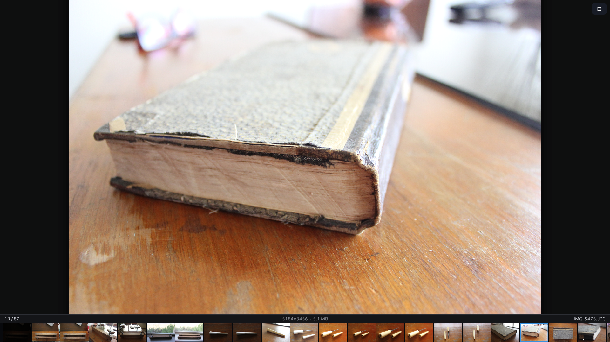

# picoSun2

A fast, minimal photo viewer for Windows. Built with Rust and egui.

[English](#picosun2) · [فارسی](#picosun2-فارسی)



## Features

**Fast photo loading**
- Full resolution, no downscaling
- Multi-threaded RAW demosaic (26MP ARW in ~4s, was 12.4s)
- Per-folder cache in a hidden `.p2cache/` folder — cold reload drops from 8.9s to 0.5s
- No 71MB RGBA copy per upload, no 53MB clone per rotate/save
- Master texture LRU-4 instead of 8 — 285MB of VRAM instead of 570MB

**Filmstrip**
- Bottom strip shows all photos in the folder
- Current photo gets a blue accent border and underline
- Thumbnails cached on disk (`.p2cache/<name>.t.png`, ~6KB each) — strip fills in **0.35s**, was 40s
- Soft placeholder slots for tiles still decoding
- Dedicated tile pool — thumbnails never starve the main photo decode

**Supported formats**
- Photos: JPG, PNG, GIF, WebP, BMP, TIFF, HEIC, AVIF, and 50+ more
- RAW: ARW, CR2, CR3, NEF, DNG, ORF, RAF, RW2, and 40+ more
- HDR: EXR, HDR, PFM, FITS
- Animated: GIF, APNG, WebP

**Navigation**
- Arrow keys or wheel to page
- Ctrl+wheel to zoom, drag to pan
- R to rotate, Ctrl+H to flip
- Ctrl+T toggles the filmstrip
- F for fullscreen
- K arms the colour picker, Ctrl+S saves the current view

**Open with**
- Registered as OpenWith for all photo and RAW formats
- Never hijacks your default apps

## Install

Download `picoSun2-setup-2.0.0.exe` from the [latest release](https://github.com/Nim4a/picoSun2/releases/latest).

Or grab the portable `picosun2.exe` directly.

## Cache

The first time you open a photo, picoSun2 caches the decoded result as a PNG inside a hidden `.p2cache/` folder next to your photos. The next open is near-instant.

- One hidden folder per photo folder — your photo folder stays clean
- Two caches inside it: the full-resolution photo (`<name>.png`) and a 147px thumbnail (`<name>.t.png`)
- Stale entries are detected automatically (source file mtime + size check)
- Delete the `.p2cache/` folder anytime to reclaim space

## Build

Requires Rust and the w64devkit toolchain.

```
cargo build --release
```

The installer requires NSIS:

```
cd installer && makensis picoSun2.nsi
```

## License

MIT

---

## picoSun2 (فارسی)

نمایشگر عکس سریع و مینیمال برای ویندوز. با Rust و egui ساخته شده.


### قابلیت‌ها

**لودینگ سریع عکس**
- رزولوشن کامل، بدون کاهش اندازه
- دیموزایک RAW چندنخی (ARW ۲۶ مگاپیکسل در ~۴ ثانیه، قبلاً ۱۲.۴ ثانیه)
- کش هر فولدر در فولدر پنهان `.p2cache/` — لود مجدد از ۸.۹ ثانیه به ۰.۵ ثانیه
- بدون کپی ۷۱ مگابایتی RGBA در هر آپلود، بدون کلون ۵۳ مگابایتی در چرخش/ذخیره
- LRU-4 برای تکسچر اصلی به‌جای ۸ — ۲۸۵ مگابایت VRAM به‌جای ۵۷۰ مگابایت

**نوار پایین (فیلم‌استریپ)**
- نوار پایین همهٔ عکس‌های فولدر را نشان می‌دهد
- عکس فعلی کادر آبی و خط زیر آبی می‌گیرد
- تامبنیل‌ها روی دیسک کش می‌شوند (`.p2cache/<name>.t.png`، حدود ۶ کیلوبایت) — نوار در **۰.۳۵ ثانیه** پر می‌شود، قبلاً ۴۰ ثانیه
- برای تامبنیل‌های در حال decode، جای خالی نرم نمایش داده می‌شود
- pool اختصاصی تامبنیل — decode عکس اصلی هرگز گرسنه نمی‌ماند

**فرمت‌های پشتیبانی‌شده**
- عکس: JPG, PNG, GIF, WebP, BMP, TIFF, HEIC, AVIF و ۵۰+ فرمت دیگر
- RAW: ARW, CR2, CR3, NEF, DNG, ORF, RAF, RW2 و ۴۰+ فرمت دیگر
- HDR: EXR, HDR, PFM, FITS
- انیمیشن: GIF, APNG, WebP

**ناوبری**
- کلید جهت‌دار یا موس برای جابجایی
- Ctrl+موس برای زوم، درگ برای پن
- R چرخش، Ctrl+H آینه افقی
- Ctrl+T نمایش/مخفی کردن نوار پایین
- F فول‌اسکرین
- K انتخاب رنگ، Ctrl+S ذخیرهٔ نمای فعلی

**Open with**
- به‌عنوان OpenWith برای همهٔ فرمت‌های عکس و RAW ثبت می‌شود
- هرگز برنامهٔ پیش‌فرض شما را عوض نمی‌کند

### نصب

`picoSun2-setup-2.0.0.exe` را از [آخرین ریلیز](https://github.com/Nim4a/picoSun2/releases/latest) دانلود کنید.

یا مستقیماً `picosun2.exe` قابل‌حمل را بردارید.

### کش

بار اول که عکسی را باز می‌کنید، picoSun2 نتیجهٔ decode را به‌صورت PNG داخل فولدر پنهان `.p2cache/` کنار عکس‌های شما ذخیره می‌کند. باز کردن بعدی تقریباً فوری است.

- یک فولدر پنهان برای هر فولدر عکس — فولدر عکس‌های شما تمیز می‌ماند
- دو کش داخل آن: عکس با رزولوشن کامل (`<name>.png`) و تامبنیل ۱۴۷ پیکسلی (`<name>.t.png`)
- ورودی‌های قدیمی خودکار تشخیص داده می‌شوند (چک mtime و size فایل اصلی)
- هر وقت خواستید `.p2cache/` را پاک کنید تا فضا آزاد شود

### بیلد

نیاز به Rust و toolchain w64devkit دارد.

```
cargo build --release
```

نصب‌کننده نیاز به NSIS دارد:

```
cd installer && makensis picoSun2.nsi
```

### لایسنس

MIT
